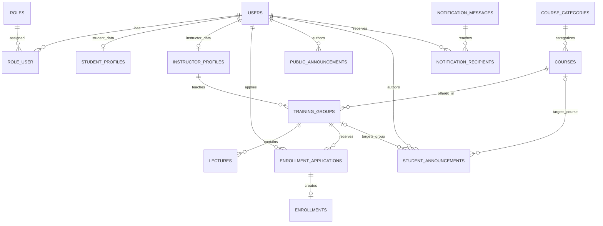

# Training Center — Database Schema & Relational Contract

> **نوع الوثيقة:** مرجع تنفيذي لقاعدة البيانات لمشروع Laravel، وليس تعليمات لتنفيذ جميع الميزات دفعة واحدة.
>
> **الإصدار:** `0.1.0-draft`  
> **آخر تحديث:** 2026-11-12  
> **المكدس:** PHP / Laravel / MySQL / Blade / Tailwind CSS / MVC  
> **لغة الشرح:** العربية، **أسماء الشيفرة والجداول:** الإنجليزية.
>
> **تعليمات إلى Codex:** اقرأ هذه الوثيقة قبل إنشاء أي Migration أو Model أو Service. نفّذ فقط الجداول والميزات التي تشملها المهمة الحالية. لا تضف حقولًا أو حالات أو جداول جديدة بناءً على تخمينات. عند اكتشاف تناقض، سجّله واسأل بدل تغييره ضمنيًا. إن تعارضت المهمة مع هذه الوثيقة، وضّح التعارض قبل التعديل. النسخة `draft` تتطلب اعتماد القرارات المفتوحة أدناه قبل أول Migration متعلق بها.

## 1. نطاق المشروع والقرارات المعتمدة مبدئيًا

النظام منصة لإدارة مركز تدريب: عرض الكورسات، تقسيمها إلى مجموعات بمواعيد ومحاضر، طلبات الطلاب، مراجعة الطلبات، التأكيد النهائي، محاضرات قابلة للتأجيل/الإلغاء، إعلانات عامة وموجهة، إشعارات داخلية، وأدوار وصلاحيات.

### ثابت في V1

1. `Course` = تعريف الكورس؛ `TrainingGroup` = طرح محدد منه؛ `Lecture` = موعد محاضرة داخل مجموعة.
2. يتم التقديم على **مجموعة** لا على كورس مجرد.
3. حساب موحد في `users`، وأدوار متعددة عبر `role_user`، مع `student_profiles` و`instructor_profiles` للبيانات الإضافية فقط.
4. جدول المحاضرات اسمه **`lectures`** وليس `sessions`؛ جدول طلبات تعديل المحاضرات **ملغى** من V1.
5. فصل الإعلانات العامة `public_announcements` عن إعلانات الطلاب `student_announcements`، مع استهداف **كورس واحد أو مجموعة واحدة** في الإعلان الموجّه.
6. نفصل طلب التسجيل عن التسجيل المؤكد؛ `enrollment_applications` لا يساوي `enrollments`.
7. **لا يوجد نظام دفع في V1**: لا `payments`، لا `is_paid`، لا `payment_confirmed_at`، ولا حالة `awaiting_payment`.
8. الرسوم (`fee_amount`) للعرض فقط. تحصيل رسوم فعلي، إن حدث خارج المنصة، **ليس شرطًا يتحقق منه النظام** في V1. عند إضافة التحكم المالي مستقبلًا، يعاد تحليل دورة التسجيل أولًا.
9. بدل حالة انتظار الدفع: **`awaiting_confirmation` = قبول مبدئي من الإدارة وانتظار تأكيد رغبة الطالب**، مع انتهاء مهلة وحجز مؤقت للمقعد.
10. الجداول التشغيلية الأساسية مصممة لتجنب تكرار الحقول المشتقة (مثل اسم المحاضر أو عدد المقاعد المتاحة).

### خارج V1

المدفوعات والأقساط/الفواتير/الاسترداد، الدفع الإلكتروني، الاختبارات، الشهادات، التقييمات، المحادثات، الحضور والغياب، قائمة الانتظار، تعدد المحاضرين للمجموعة الواحدة، إنشاء جدول محاضرات متكرر معقد، سجل تدقيق كامل للتعديلات.

### افتراضات عمل تحتاج تثبيتًا قبل تنفيذ دورتها

- **A1 — تأكيد الطالب:** بعد قبول الإدارة يضغط الطالب «تأكيد الالتحاق»، وينشأ التسجيل مباشرة إن كان المقعد المحجوز صالحًا. **هذا افتراض معماري لهذه النسخة، وليس قرارًا نهائيًا سبق أن صرّح به صاحب المشروع.**
- **A2 — مهلة التأكيد:** تُحَدَّد من إعداد ثابت في التطبيق في V1 (مثل 48 ساعة)، وليست عمودًا إضافيًا في جدول إعدادات؛ لا تُنفَّذ قيمة افتراضية دون مناقشة زمن المهلة.
- **A3 — المحاضر:** محاضر أساسي واحد لكل مجموعة. دعم عدة محاضرين مؤجل.
- **A4 — إعادة التقديم:** طلب واحد فقط لكل `(student_user_id, training_group_id)`. يمكن للإدارة إعادة فتح **الطلب نفسه** بضوابط، ولا ينشئ الطالب طلبًا ثانيًا مستقلًا.
- **A5 — التغيير في المحاضرات:** يسمح للمسؤول المخول بتعديل الموعد/الإلغاء مباشرة؛ تفاصيل قدرة المحاضر على التعديل الذاتي تحدد في دورة المحاضرات.
- **A6 — الإشعارات:** التصميم الحالي يستخدم رسائل ومستلمين منفصلين لخفض تكرار النص، وليس جداول Laravel Database Notifications القياسية. يُراجع الاختيار عند بدء دورة الإشعارات لتقدير كلفة التكامل.
- **A7 — إعلان الكورس:** يراه جميع الطلاب أصحاب التسجيلات النشطة ضمن أي مجموعة لذلك الكورس، وإعلان المجموعة يراه أصحاب التسجيلات النشطة في المجموعة فقط.

## 2. قواعد التسمية والأنواع

- كل `id` رقمي هو `BIGINT UNSIGNED AUTO_INCREMENT PRIMARY KEY` ما لم يُذكر خلافه (`$table->id()` في Laravel).
- كل `*_id` خارجي مطابق للنوع `BIGINT UNSIGNED` (`foreignId`).
- حقول الوقت `DATETIME`، مع التعامل مع التاريخ والوقت داخل التطبيق وفق UTC، وإظهار المنطقة الزمنية في الواجهة حسب إعداد المركز.
- كل جدول عملي يستخدم `created_at` و`updated_at` (`timestamps`) إلا إذا حدد خلاف ذلك.
- لا تستخدم `FLOAT` أو `DOUBLE` للأموال؛ استخدم `DECIMAL(10,2)`.
- القيم المسماة للحالات في حقول `status` هي **عقد برمجي** (`string` + validation / enum في PHP)، ويُمنع اختراع حالات جديدة دون تحديث هذا المرجع.
- يُفضّل `RESTRICT`/`NO ACTION` لحذف السجلات التاريخية المهمة، وتعطيل الحسابات أو الكورسات بدل حذفها؛ علاقات الربط البسيطة يمكن أن تستخدم `CASCADE` حسب سياسة الحذف.
- الأسماء المعروضة في الجداول نصل إليها بالعلاقات، ولا ننشئ نسخًا منها في جداول أبنائها.
- جداول Laravel البنيوية (`migrations`, `password_reset_tokens`, `cache`, `jobs`, `sessions` إن استخدمت جلسات قاعدة البيانات، وغيرها) ليست جزءًا من عدد **جداول المجال** التالية، ويمكن توليدها من إطار العمل عند الحاجة. وجود جدول Laravel التقني `sessions` لا يلغي اعتماد `lectures` للمحاضرات.

## 3. قاموس البيانات (15 جدول مجال)

### 3.1 `users` — الحسابات

| العمود | النوع | القيود / الغرض |
|---|---|---|
| `id` | BIGINT UNSIGNED | PK |
| `name` | VARCHAR(150) | NOT NULL؛ الاسم المعروض |
| `email` | VARCHAR(255) | NOT NULL, UNIQUE |
| `email_verified_at` | DATETIME | NULL |
| `password` | VARCHAR(255) | NOT NULL؛ hash فقط |
| `is_active` | BOOLEAN | NOT NULL DEFAULT TRUE |
| `remember_token` | VARCHAR(100) | NULL |
| `created_at`, `updated_at` | TIMESTAMP | Laravel |

- لا نخزن `role` داخل `users`؛ الأدوار في `role_user`.
- لا تحذف مستخدمًا لديه علاقات تاريخية مهمة؛ عطّل الحساب.

### 3.2 `roles` — الأدوار

| العمود | النوع | القيود / الغرض |
|---|---|---|
| `id` | BIGINT UNSIGNED | PK |
| `name` | VARCHAR(50) | NOT NULL, UNIQUE |

- القيم الأولية عبر seeder: `admin`, `staff`, `instructor`, `student`.
- لا تحتاج هذه القائمة إلى نظام Permissions ديناميكي في V1؛ استخدم Laravel Policies/Gates للتحكم التفصيلي.

### 3.3 `role_user` — وسيط المستخدمين والأدوار

| العمود | النوع | القيود / الغرض |
|---|---|---|
| `user_id` | BIGINT UNSIGNED | FK → `users.id` |
| `role_id` | BIGINT UNSIGNED | FK → `roles.id` |

- **PK مركب:** `(user_id, role_id)`؛ يمنع تكرار نفس الدور للمستخدم.
- علاقات الـ pivot يجوز حذفها متسلسلًا عند حذف الطرف إذا كانت سياسة النظام تسمح بحذفه أصلًا.

### 3.4 `student_profiles` — تفاصيل الطلاب

| العمود | النوع | القيود / الغرض |
|---|---|---|
| `user_id` | BIGINT UNSIGNED | **PK + FK** → `users.id` |
| `phone_number` | VARCHAR(30) | NULL مبدئيًا؛ يجب إدخاله قبل طلب التسجيل إن اعتُمد ذلك في دورة التسجيل |
| `date_of_birth` | DATE | NULL |
| `education_level` | VARCHAR(100) | NULL؛ إدخال حر في V1 |
| `institution_name` | VARCHAR(150) | NULL |
| `city` | VARCHAR(100) | NULL |
| `created_at`, `updated_at` | TIMESTAMP | Laravel |

- العلاقة `users 1 — 0..1 student_profiles`.
- لا تكرر `name`، `email`، أو `password` هنا.
- وجود ملف طالب ودور طالب شرطان يُتحقق منهما في التطبيق عند التقديم.

### 3.5 `instructor_profiles` — تفاصيل المحاضرين

| العمود | النوع | القيود / الغرض |
|---|---|---|
| `user_id` | BIGINT UNSIGNED | **PK + FK** → `users.id` |
| `professional_title` | VARCHAR(150) | NULL |
| `biography` | TEXT | NULL |
| `experience_years` | SMALLINT UNSIGNED | NULL |
| `created_at`, `updated_at` | TIMESTAMP | Laravel |

- العلاقة `users 1 — 0..1 instructor_profiles`.
- كل مجموعة تشير إلى `instructor_profiles.user_id`، مع التحقق أيضًا من دور `instructor` في التطبيق.

### 3.6 `course_categories` — تصنيفات الكورسات

| العمود | النوع | القيود / الغرض |
|---|---|---|
| `id` | BIGINT UNSIGNED | PK |
| `name` | VARCHAR(120) | NOT NULL, UNIQUE |
| `slug` | VARCHAR(150) | NOT NULL, UNIQUE |
| `created_at`, `updated_at` | TIMESTAMP | Laravel |

### 3.7 `courses` — تعريف الكورس

| العمود | النوع | القيود / الغرض |
|---|---|---|
| `id` | BIGINT UNSIGNED | PK |
| `category_id` | BIGINT UNSIGNED | NOT NULL, FK → `course_categories.id` |
| `title` | VARCHAR(200) | NOT NULL |
| `slug` | VARCHAR(220) | NOT NULL, UNIQUE |
| `description` | TEXT | NULL |
| `planned_hours` | DECIMAL(6,2) | NULL, CHECK > 0 عند وجود قيمة |
| `is_published` | BOOLEAN | NOT NULL DEFAULT FALSE |
| `created_at`, `updated_at` | TIMESTAMP | Laravel |

- لا نخزن مواعيد المجموعات أو اسم المحاضر هنا.
- الكورس المنشور قد تكون له صفر أو أكثر من مجموعة.

### 3.8 `training_groups` — طرح الكورس كمجموعة

| العمود | النوع | القيود / الغرض |
|---|---|---|
| `id` | BIGINT UNSIGNED | PK |
| `course_id` | BIGINT UNSIGNED | NOT NULL, FK → `courses.id` |
| `instructor_user_id` | BIGINT UNSIGNED | NOT NULL, FK → `instructor_profiles.user_id` |
| `code` | VARCHAR(50) | NOT NULL, UNIQUE |
| `capacity` | SMALLINT UNSIGNED | NOT NULL, CHECK > 0 |
| `fee_amount` | DECIMAL(10,2) | NULL, CHECK >= 0 عند وجود قيمة؛ **للعرض فقط** |
| `currency_code` | CHAR(3) | NULL إذا كانت الرسوم غير محددة؛ مثل `LYD` |
| `registration_opens_at` | DATETIME | NOT NULL |
| `registration_closes_at` | DATETIME | NOT NULL؛ CHECK > opens |
| `status` | VARCHAR(30) | NOT NULL DEFAULT `draft` |
| `created_at`, `updated_at` | TIMESTAMP | Laravel |

**قيم `status`:** `draft`, `published`, `in_progress`, `completed`, `cancelled`.

- حالة **فتح التسجيل** ليست قيمة `open` مخزنة ثانية: تتحقق من `status = published`، وأن الوقت الحالي داخل نافذة التسجيل، وأن هناك مقاعد غير مشغولة أو محجوزة.
- عدم ظهور مجموعات مغلقة للتقديم لا يعني حذفها من الواجهات العامة؛ تظهر مع علامة مغلق حسب متطلبات الصفحة.
- بداية المجموعة ونهايتها المجدولتان يمكن اشتقاقهما من `MIN(lectures.starts_at)` و`MAX(lectures.ends_at)`؛ لا تكرر هذه التواريخ دون متطلب مستقل.
- قواعد تغيير `capacity` يجب أن ترفض أي تخفيض أسفل العدد المشغول والمحجوز حاليًا.

### 3.9 `lectures` — المحاضرات التابعة للمجموعة

| العمود | النوع | القيود / الغرض |
|---|---|---|
| `id` | BIGINT UNSIGNED | PK |
| `training_group_id` | BIGINT UNSIGNED | NOT NULL, FK → `training_groups.id` |
| `lecture_number` | SMALLINT UNSIGNED | NOT NULL, CHECK > 0 |
| `title` | VARCHAR(200) | NULL؛ عنوان اختياري للمحاضرة |
| `starts_at` | DATETIME | NOT NULL |
| `ends_at` | DATETIME | NOT NULL, CHECK > starts_at |
| `status` | VARCHAR(20) | NOT NULL DEFAULT `scheduled` |
| `change_reason` | TEXT | NULL؛ سبب **آخر** تغيير فقط |
| `created_at`, `updated_at` | TIMESTAMP | Laravel |

- **UNIQUE:** `(training_group_id, lecture_number)`.
- **قيم `status`:** `scheduled`, `completed`, `cancelled`.
- التأجيل يعني تعديل `starts_at`/`ends_at`، وليس حالة دائمة `postponed`؛ ويُحدَّث سبب آخر تغيير فقط. **لا يوجد سجل تاريخ كامل للمواعيد في V1**.
- يمكن توليد المحاضرات مرة واحدة من إدخال جدول أسبوعي في واجهة إنشاء المجموعة؛ لا حاجة إلى تخزين قاعدة تكرار أسبوعية في V1.
- فحص تداخل المحاضرات للمحاضر يتم في خدمة Laravel داخل Transaction، ولا يضمنه FK وحده.

### 3.10 `enrollment_applications` — طلبات الانضمام للمجموعات

| العمود | النوع | القيود / الغرض |
|---|---|---|
| `id` | BIGINT UNSIGNED | PK |
| `student_user_id` | BIGINT UNSIGNED | NOT NULL, FK → `users.id` |
| `training_group_id` | BIGINT UNSIGNED | NOT NULL, FK → `training_groups.id` |
| `status` | VARCHAR(30) | NOT NULL DEFAULT `pending` |
| `reviewed_by_user_id` | BIGINT UNSIGNED | NULL, FK → `users.id` |
| `reviewed_at` | DATETIME | NULL |
| `rejection_reason` | TEXT | NULL |
| `offer_expires_at` | DATETIME | NULL؛ نهاية مهلة تأكيد العرض |
| `created_at`, `updated_at` | TIMESTAMP | Laravel |

- **UNIQUE:** `(student_user_id, training_group_id)`؛ طلب واحد لكل طالب ومجموعة.
- **قيم `status`:** `pending`, `awaiting_confirmation`, `rejected`, `expired`, `cancelled`, `completed`.
- `awaiting_confirmation` = وافقت الإدارة مبدئيًا وحجزت مقعدًا مؤقتًا بمهلة `offer_expires_at`؛ **لا علاقة لها بالدفع**.
- `completed` = تم إنشاء `enrollments` وتأكيد الانضمام.
- لا يسمح بتغيير `student_user_id` أو `training_group_id` بعد إنشاء الطلب.
- الطلب المرفوض يمكن إعادة فتحه **كسجل نفسه** فقط من خلال إجراء إداري صريح بعد الاتفاق على تفاصيله.

### 3.11 `enrollments` — العضويات المؤكدة في المجموعات

| العمود | النوع | القيود / الغرض |
|---|---|---|
| `id` | BIGINT UNSIGNED | PK |
| `application_id` | BIGINT UNSIGNED | NOT NULL, UNIQUE, FK → `enrollment_applications.id` |
| `status` | VARCHAR(20) | NOT NULL DEFAULT `active` |
| `enrolled_at` | DATETIME | NOT NULL |
| `withdrawn_at` | DATETIME | NULL |
| `created_at`, `updated_at` | TIMESTAMP | Laravel |

- **قيم `status`:** `active`, `withdrawn`.
- لا تكرر `student_user_id` أو `training_group_id` هنا؛ نصل إليهما عبر التطبيق `enrollments → enrollment_applications`.
- تنشأ العضوية **فقط** بعد تأكيد الطالب في V1، وبنفس Transaction التي تغيّر التطبيق إلى `completed`.
- الانسحاب يغيّر حالة العضوية إلى `withdrawn` ولا يحذف سجلها.

### 3.12 `public_announcements` — الإعلانات العامة للزوار

| العمود | النوع | القيود / الغرض |
|---|---|---|
| `id` | BIGINT UNSIGNED | PK |
| `author_user_id` | BIGINT UNSIGNED | NOT NULL, FK → `users.id` |
| `title` | VARCHAR(200) | NOT NULL |
| `body` | TEXT | NOT NULL |
| `image_path` | VARCHAR(500) | NULL؛ مسار صورة اختياري لا الملف نفسه |
| `published_at` | DATETIME | NULL؛ NULL = مسودة، تاريخ مستقبلي = مجدول |
| `created_at`, `updated_at` | TIMESTAMP | Laravel |

- الإعلان مرئي للعامة فقط إذا `published_at <= now()`؛ الصلاحيات على الإنشاء والتعديل للإدارة.

### 3.13 `student_announcements` — إعلانات كورس أو مجموعة

| العمود | النوع | القيود / الغرض |
|---|---|---|
| `id` | BIGINT UNSIGNED | PK |
| `author_user_id` | BIGINT UNSIGNED | NOT NULL, FK → `users.id` |
| `course_id` | BIGINT UNSIGNED | NULL, FK → `courses.id` |
| `training_group_id` | BIGINT UNSIGNED | NULL, FK → `training_groups.id` |
| `title` | VARCHAR(200) | NOT NULL |
| `body` | TEXT | NOT NULL |
| `published_at` | DATETIME | NULL |
| `created_at`, `updated_at` | TIMESTAMP | Laravel |

- **XOR CHECK:** إما `course_id IS NOT NULL` وإما `training_group_id IS NOT NULL`، **وليس كليهما** ولا كلاهما NULL.
- لا يُنشأ جدول يكرر قائمة الطلاب المستهدفين؛ يحدد المستلمون أثناء الاستعلام عن التسجيلات النشطة.
- يرى الطالب الإعلان فقط إذا عنده `enrollments.status = active` لمجموعة تطابق الاستهداف.
- قرار نطاق نشر المحاضر (هل ينشر لمجموعته فقط أم يرسل طلب موافقة) يُحسم في دورة الإعلانات، لا بافتراضات في الواجهة.

### 3.14 `notification_messages` — نصوص الإشعارات

| العمود | النوع | القيود / الغرض |
|---|---|---|
| `id` | BIGINT UNSIGNED | PK |
| `type` | VARCHAR(50) | NOT NULL؛ مثل `application_reviewed`, `lecture_changed` |
| `title` | VARCHAR(200) | NOT NULL |
| `body` | TEXT | NOT NULL |
| `created_at` | TIMESTAMP | NOT NULL |

- رسالة واحدة يمكن توجيهها لعدة مستخدمين، دون تكرار نصها في كل سجل مستلم.

### 3.15 `notification_recipients` — المستلمون وقراءة الإشعارات

| العمود | النوع | القيود / الغرض |
|---|---|---|
| `id` | BIGINT UNSIGNED | PK |
| `notification_message_id` | BIGINT UNSIGNED | NOT NULL, FK → `notification_messages.id` |
| `user_id` | BIGINT UNSIGNED | NOT NULL, FK → `users.id` |
| `read_at` | DATETIME | NULL |

- **UNIQUE:** `(notification_message_id, user_id)`.
- يمكن إضافة `created_at` لتتبع وقت التسليم منفصلًا عن تاريخ إنشاء الرسالة إن كانت هناك حاجة لذلك.

### تنبيه بخصوص عدد الجداول

يحتوي هذا العقد على **15 جدول مجال** (`users`, `roles`, `role_user`, `student_profiles`, `instructor_profiles`, `course_categories`, `courses`, `training_groups`, `lectures`, `enrollment_applications`, `enrollments`, `public_announcements`, `student_announcements`, `notification_messages`, `notification_recipients`). **هذا العدد هو الصحيح**؛ الدفع كان جدولًا سادس عشر في التصميم السابق وقد حُذف من V1. لا تُنشئ جدولًا سادس عشر لمجرد مطابقة ترقيم سابق.

## 4. ERD — العلاقات فقط



> القيم `reviewed_by_user_id` وكذلك مفاتيح المؤلف والطالب تشير إلى `users.id`؛ جرى اختصار بعض علاقات المراجعة في الرسم لتجنب ازدحامه. الوثيقة الجدولية أعلاه هي مصدر الحقيقة لجميع المفاتيح الخارجية.

### علاقات Eloquent المرجعية (تسمية مقترحة)

| Model | العلاقات المطلوبة | ملاحظات |
|---|---|---|
| `User` | `roles(): belongsToMany(Role)`، `studentProfile(): hasOne(StudentProfile)`، `instructorProfile(): hasOne(InstructorProfile)` | استخدم `user_id` كمفتاح في الملفين الشخصيين |
| `CourseCategory` | `courses(): hasMany(Course)` | FK: `category_id` |
| `Course` | `category(): belongsTo(CourseCategory)`، `trainingGroups(): hasMany(TrainingGroup)` | `category_id` |
| `InstructorProfile` | `user(): belongsTo(User)`، `trainingGroups(): hasMany(TrainingGroup)` | مفتاح الملف هو `user_id`؛ مفتاح المجموعة `instructor_user_id` |
| `TrainingGroup` | `course(): belongsTo(Course)`، `instructor(): belongsTo(InstructorProfile)`، `lectures(): hasMany(Lecture)`، `applications(): hasMany(EnrollmentApplication)` | مفاتيح المحاضر والمحاضرات والتطبيق ليست كلها Laravel defaults؛ حددها صراحة |
| `Lecture` | `trainingGroup(): belongsTo(TrainingGroup)` | FK: `training_group_id` |
| `EnrollmentApplication` | `student(): belongsTo(User)`، `trainingGroup(): belongsTo(TrainingGroup)`، `enrollment(): hasOne(Enrollment)` | FK الطالب `student_user_id` |
| `Enrollment` | `application(): belongsTo(EnrollmentApplication)` | FK: `application_id`؛ الطالب والمجموعة عبر الطلب |
| `StudentAnnouncement` | `course(): belongsTo(Course)`، `trainingGroup(): belongsTo(TrainingGroup)` | أحدهما فقط غير NULL |
| `NotificationMessage` | `recipients(): hasMany(NotificationRecipient)` | الرسالة مشتركة بين المستلمين |
| `NotificationRecipient` | `user(): belongsTo(User)`، `message(): belongsTo(NotificationMessage)` | FK الرسالة `notification_message_id` |

> هذه أسماء مبدئية لعلاقات الـ Models، وليست مبررًا لإضافة أعمدة غير محددة في قاموس البيانات. يمكن استخدام `hasManyThrough` أو استعلامات `whereHas` عند الحاجة، دون نسخ مفاتيح الطالب والمجموعة في `enrollments`.

## 5. قيود البيانات ومنع التكرار

| قاعدة | مكان التنفيذ |
|---|---|
| بريد فريد | `UNIQUE(users.email)` |
| دور لا يتكرر لمستخدم | `PRIMARY KEY(role_user.user_id, role_user.role_id)` |
| كورس له رابط فريد | `UNIQUE(courses.slug)` |
| مجموعة برمز فريد | `UNIQUE(training_groups.code)` |
| ترتيب محاضرة لا يتكرر في المجموعة | `UNIQUE(lectures.training_group_id, lectures.lecture_number)` |
| طلب واحد لكل طالب ومجموعة | `UNIQUE(enrollment_applications.student_user_id, enrollment_applications.training_group_id)` |
| تسجيل مؤكد واحد لكل طلب | `UNIQUE(enrollments.application_id)` |
| لا يتكرر نفس المستلم لنفس الإشعار | `UNIQUE(notification_recipients.notification_message_id, notification_recipients.user_id)` |
| سعة موجبة، رسوم غير سالبة، نهاية بعد بداية | `CHECK` في MySQL + Validation في Laravel |
| إعلان طالب مستهدف لكورس أو مجموعة فقط | `CHECK` XOR + Validation في Laravel |
| الطالب مؤهل للتقديم، والمجموعة تقبل التسجيل | Laravel Service / Policy |
| المحاضر له دور صحيح ومواعيده غير متعارضة | Laravel Service + Lock داخل Transaction |
| لا يتجاوز التسجيل المؤكد والحجوزات المؤقتة السعة | **Database Transaction + `lockForUpdate()` على المجموعة** |

**ملاحظة توافق:** قيد `CHECK` يفترض إصدار MySQL يدعم تنفيذ القيود فعليًا (MySQL 8.0.16 أو أحدث). التحقق في Laravel لا يلغي فائدة قيد قاعدة البيانات.

### حساب إشغال المجموعة

لا تضف عمود `enrolled_count` أو `available_seats` في V1.

```
occupied = count(enrollments where status = active, via applications of group)
reserved = count(applications where status = awaiting_confirmation
                 and offer_expires_at > now(),
                 excluding applications that already have active enrollment)
available = max(0, training_groups.capacity - occupied - reserved)
```

- `pending` لا يحجز مقعدًا.
- `rejected`, `cancelled`, `expired` لا تحجز مقاعد.
- عند تحويل `awaiting_confirmation` إلى `completed` في نفس المعاملة: يقل الحجز ويزيد التسجيل المؤكد دون زيادة إشغال المجموعة.
- لا يُقبل تأكيد طالب بعد انتهاء `offer_expires_at`.
- يمكن لعملية مجدولة تحويل العروض المنتهية إلى `expired` لأجل العرض والتقارير؛ احتساب المقاعد لا يتوقف على تشغيلها لأن التاريخ يُفحص عند الحساب.

## 6. دورة التسجيل — عقد حالات V1 (افتراض A1)

```text
pending  --admin approves & reserves--> awaiting_confirmation
pending  --admin rejects-------------> rejected
pending  --student cancels-----------> cancelled
awaiting_confirmation --student confirms before deadline--> completed + enrollment(active)
awaiting_confirmation --deadline passes-------------------> expired
awaiting_confirmation --student cancels------------------> cancelled
```

- لا توجد حالة `awaiting_payment` ولا `is_paid`؛ المشروع لا يتتبع الأموال في V1.
- تأكيد الطالب يعبر عن رغبته، **ولا يثبت دفعًا ماليًا**.
- يمكن أن يعتمد المشروع بدلاً من زر الطالب «تأكيد إداري نهائي»؛ هذا قرار مفتوح يجب حسمه قبل كتابة Service التسجيل.
- منطق الموافقة والتأكيد والانتهاء والانسحاب يجب أن يمنع تكرار التنفيذ وأن يكون قابلًا للإعادة الآمنة (`idempotent` عند اللزوم).
- تنفيذ تغيير حالة وخلق Enrollment داخل **Transaction واحدة** مع قفل سجل `training_groups` الذي يمثل مورد السعة المتنازع عليه.

## 7. سياسات العلاقات والحذف والوصول

1. يحق للزائر مشاهدة الكورسات المنشورة والمجموعات المسموح بعرضها والإعلانات العامة المنشورة فقط.
2. الطالب يستطيع إنشاء/عرض/إلغاء طلباته المسموح بها، وتأكيد عرضه المقبول، وعرض إعلانات مجموعاته/كورسات تسجيلاته النشطة فقط.
3. المحاضر يستطيع عرض المجموعات والطلاب المؤكدين والمحاضرات المسندة إليه فقط؛ لا يعتمد الوصول على معرف `group_id` القادم من URL وحده.
4. الإدارة/الموظف المخوّل يراجع الطلبات ويدير المجموعات ضمن Policy محددة.
5. لا تحذف السجلات التشغيلية المرجعية (`applications`, `enrollments`, `lectures`) تلقائيًا بحذف الكورس/المجموعة؛ استخدم حالات وتعطيل أو حذفًا مقيّدًا `RESTRICT` بحسب السياق.
6. لا تعتمد على إخفاء أزرار Blade لضبط الصلاحيات؛ التحقق واجب في Controller / Policy / Service.
7. لا تُنشئ بيانات المستخدم أو أدواره تلقائيًا من مدخلات غير موثوقة دون تحقق وصلاحية واضحة.

## 8. فهارس موصى بها بجانب الـ UNIQUE والـ FK

- `training_groups(course_id, status)`، و`training_groups(instructor_user_id)`.
- `lectures(training_group_id, starts_at)`؛ وللكشف عن تداخل محاضرات المحاضر يتم الربط مع مجموعته.
- `enrollment_applications(training_group_id, status, offer_expires_at)` و`(student_user_id, status)`.
- `enrollments(status)` وقد تحتاج استعلامات الإشغال join إلى فهارس FK الموجودة.
- `public_announcements(published_at)`.
- `student_announcements(course_id, published_at)`، و`(training_group_id, published_at)`.
- `notification_recipients(user_id, read_at)`.

> قيّم الفهارس بعد تنفيذ الاستعلامات الفعلية؛ MySQL قد ينشئ بعضها تلقائيًا للمفاتيح الخارجية. لا تكرر فهارس مكافئة دون حاجة.

## 9. ترتيب Migrations المقترح

1. `users`, `roles`, `role_user`, `student_profiles`, `instructor_profiles`.
2. `course_categories`, `courses`, `training_groups`, `lectures`.
3. `enrollment_applications`, `enrollments`.
4. `public_announcements`, `student_announcements`.
5. `notification_messages`, `notification_recipients`.

> لا تعني القائمة السابقة تنفيذ جميع الـ Migrations دفعة واحدة. نفّذ كل جزء مع الوظيفة التي تستخدمه، وتأكد من أن أسماء migrations وأسبقيتها تحترم FKs.

## 10. بروتوكول العمل مع Codex (إلزامي لكل دورة)

لكل دورة تطوير يتم إنشاء برومبت مستقل يحتوي حرفيًا على هذه المحاور:

1. **Goal:** الهدف وسلوك المستخدم المتوقع بلغة قابلة للاختبار.
2. **Scope:** الملفات والمكونات والجداول المسموح تعديلها وإنشاؤها.
3. **Out of scope:** ما يجب ألا يلمسه Codex حتى لو رآه مفيدًا.
4. **Database contract:** أسماء الجداول والأعمدة والـ FK والـ UNIQUE والحالات من هذا الملف **دون تعديل تخميني**.
5. **Business rules:** عمليات الانتقال والحالات الفاشلة والصلاحيات والحدود.
6. **UI contract:** الواجهات المطلوبة ومصدر تصميم Stitch إن وجد، والتوافق مع Blade/Tailwind.
7. **Acceptance tests:** اختبارات نجاح وفشل وأمان وتزامن عند الحاجة.
8. **Deliverables:** قائمة الملفات المعدلة، قرارات التنفيذ، أوامر الاختبار ونتائجها، والمخاطر المتبقية.

**قاعدة إنتاجية:** دورة واحدة = ميزة عمودية صغيرة تشتغل من قاعدة البيانات إلى الواجهة والاختبار، وليس عشرات ملفات UI ثم عشرات Controllers ثم الربط لاحقًا.

**DoD — تعريف الانتهاء:**

- تتطابق Migrations/Models مع هذا العقد أو يوجد تعديل موثق ومعتمد لهذا العقد.
- اختبارات الـ Feature/Unit الأساسية تمر، بما فيها Forbidden وValidation والحالات الحدّية.
- لا N+1 ظاهر في قوائم المستخدمين/المجموعات؛ استخدام eager loading عند الحاجة.
- الصفحة تعمل على الموبايل والكمبيوتر، وتدعم RTL عربيًا، ورسائل الخطأ والنجاح صحيحة.
- لا أسرار أو مفاتيح API أو بيانات إنتاجية في المستودع أو برومبتات Codex.
- لا Migration مدمرة أو تغييرات منطقية غير متفق عليها.

## 11. التعامل مع Stitch / MCP

- Stitch **مصدر لواجهة المستخدم**: مخططات/تصاميم/مكونات/أصول بصرية، وليس مصدرًا لصلاحيات أو قواعد البيانات أو منطق التسجيل.
- قبل اعتماد MCP: تحقّق من وجود موصل رسمي/موثوق، طريقة المصادقة، الصلاحيات، وهل يعرض التصميم/الأصول أو كودًا قابلًا للاستيراد؛ لا تفترض أن الربط متاح تلقائيًا.
- إن توفّر، اطلب من Codex تحويل التصميم إلى **Blade + Tailwind** متوافق مع بنية المشروع الحالية، دون تغيير routes/models/validation تلقائيًا بسبب تصميم الواجهة.
- ابدأ بتصميم النظام البصري (الألوان، الخطوط، المسافات، الأزرار، النماذج، جداول العرض) + صفحتين مرجعيتين قبل بقية الصفحات.
- احرص على RTL، responsive، تسلسل التركيز بلوحة المفاتيح، حالات loading/empty/error، وعدم نسخ محتوى تجريبي على أنه بيانات حقيقية.
- افصل طبقة التصميم (Blade components) عن استدعاءات قاعدة البيانات داخل Controllers/Services.
- راجع مصدر الأصول والتراخيص، ولا تسمح لتصميم خارجي بإدخال شيفرة غير موثوقة إلى المشروع دون فحص.

## 12. قواعد التغيير والتطوير المستقبلي

- هذه الوثيقة **مصدر الحقيقة للبنية العلائقية**؛ أي تعديل يتطلب تحديث النسخة والتاريخ وقسم القرار قبل مطالبة Codex بالتنفيذ.
- عند بدء دورة التسجيل، حسم A1 وA2 وA4؛ وعند المحاضرات حسم A5؛ وعند الإشعارات حسم A6.
- إذا أضفنا الدفع مستقبلًا: لا تضف عمود `is_paid` دون تحليل المتطلبات، بل ناقش هل الدفع دفعة واحدة أم أقساط، وهل توجد استردادات، وما معنى «تم الدفع»، وهل يلزم توثيق المبالغ وتاريخها وحالتها؛ ثم صمم كيان Payments المناسب.
- إذا أضفنا عدة محاضرين للمجموعة: انتقل إلى `group_instructors` بدل الجمع بينه وبين `training_groups.instructor_user_id` دون قاعدة واضحة.
- إذا احتجنا سجل تعديلات المحاضرات: أضف جدول audit/change history بدل وضع مصفوفة JSON من التعديلات داخل `lectures`.
- إذا احتجنا محاولات طلب متكررة مستقلة: أعد تحليل قيد `UNIQUE(student_user_id, training_group_id)` وأنشئ نموذج محاولات واضحًا، ولا تحذف القيد بشكل عشوائي.

---

**خلاصة لـ Codex:** لا تبدأ تنفيذًا شاملًا انطلاقًا من هذا الملف وحده؛ انتظر برومبت الدورة الحالية، وطبّق فقط ما يدخل في نطاقها، وأبلغ عن القرارات المعلّقة بدل ملء الفراغات بافتراضات.
